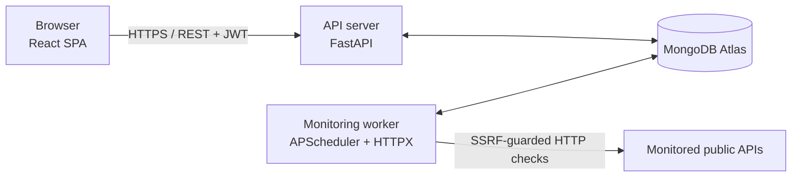

<div align="center">

# APIWatch

**API uptime and performance monitoring platform**

Track the availability, status codes and response times of your APIs from a single dashboard. Get incidents opened and resolved automatically.

[](https://github.com/YOUR_USERNAME/apiwatch/actions/workflows/ci.yml)


</div>

---

## Screenshots

| Dashboard | Monitor details |
|---|---|
|  |  |

| Monitors | Incidents |
|---|---|
|  |  |

## Features

- **Authentication:** registration, login, JWT sessions, protected routes. Every user only ever sees their own data.
- **Monitor management:** create, edit, pause/resume and delete monitors (GET, POST, PUT, DELETE), with a configurable interval, timeout and expected status codes.
- **Automatic monitoring engine:** a dedicated worker checks every active monitor on schedule and records status, HTTP code and response time. Timeouts and connection errors are handled gracefully.
- **Manual checks:** run a check on demand with one click.
- **Incident management:** an incident opens when an API goes DOWN and is resolved, with its duration computed, when it comes back UP.
- **Dashboard:** total, up and down counts, average response time, uptime percentage, recent incidents and status overview, plus response-time, availability and check-history charts over 1 h, 24 h, 7 d or 30 d.
- **Monitor details page:** latest status, uptime, a heartbeat bar of recent checks, charts, paginated check history and incident history.
- **Responsive UI:** sidebar navigation, loading, empty and error states, and confirmation dialogs for destructive actions.

## Architecture



The API server and the worker never talk to each other directly: **MongoDB is their only meeting point**.

### Why a separate worker?

Running the scheduler inside the web server would let slow checks hurt API responsiveness, and running two server copies would run two schedulers. The worker is therefore its own process (same Docker image, different command):

1. Every 10 seconds one scheduler job wakes up.
2. It **atomically claims** the monitors that are due (`find_one_and_update` pushes `next_check_at` forward in the same operation), so two workers can never check the same monitor twice.
3. Claimed monitors are checked concurrently (bounded by a semaphore).
4. Each result is stored, the monitor's latest state is updated, and incidents are opened or resolved.

## Tech stack

| Layer | Technologies |
|---|---|
| Frontend | React, Vite, Tailwind CSS, Recharts, Axios, React Router, Vitest + Testing Library |
| Backend | Python 3.12, FastAPI, Pydantic v2, PyMongo Async driver, HTTPX, APScheduler, PyJWT, Argon2, slowapi |
| Database | MongoDB (Atlas in the cloud, or a local container) |
| DevOps | Docker, Docker Compose, nginx, GitHub Actions |
| Cloud target | Microsoft Azure (see [`docs/AZURE.md`](docs/AZURE.md)) |

## Security

Security is a first-class requirement of this project.

- **Passwords** are hashed with Argon2id. Login takes the same time whether or not the email exists.
- **JWT** access tokens with a short expiry. Secrets only come from environment variables.
- **Ownership is enforced on every query.** Another user's resource returns `404`, never `403`, so IDs cannot be probed.
- **Input validation** with Pydantic on every endpoint.
- **Rate limiting** on registration, login and manual checks, plus a per-user monitor limit and a minimum check interval.
- **SSRF protection** (see [`backend/app/security/ssrf.py`](backend/app/security/ssrf.py)), because the server fetches user-supplied URLs:
  - only `http` and `https`, restricted ports, no credentials in the URL, blocked host names (`localhost`, `*.internal`, ...);
  - DNS is resolved by the server and **every** resolved IP must be public (loopback, private ranges, link-local including the cloud metadata address `169.254.169.254`, multicast and reserved ranges are rejected);
  - the request connects to the **validated IP**, so DNS rebinding cannot swap the target afterwards;
  - redirects are followed manually and **re-validated at every hop**;
  - response bodies are never downloaded.
- **CORS** restricted to the configured frontend origin. The containers run as a non-root user.

> Known trade-off: the JWT is kept in `localStorage` for simplicity. An httpOnly cookie with CSRF protection would be stronger against XSS and is listed in the roadmap.

## Data model

| Collection | Purpose | Key indexes |
|---|---|---|
| `users` | Accounts | unique `email` |
| `monitors` | Monitor configuration and latest state | `(user_id, created_at)`, `(is_active, next_check_at)` |
| `check_results` | One document per check | `(monitor_id, checked_at)`, **TTL** on `checked_at` (30 days) |
| `incidents` | Outage periods | `(user_id, started_at)`, `(monitor_id, started_at)`, **unique partial index**: one `OPEN` incident per monitor |

Check results reference their monitor instead of being embedded, because they grow without bound (one monitor checked every minute produces 1,440 documents a day). The latest state is denormalised onto the monitor so the dashboard does not need a query per monitor.

## Getting started

### Prerequisites

[Docker Desktop](https://www.docker.com/products/docker-desktop/) is enough for the quick start. To run without Docker you need Python 3.12 and Node.js 22.

### Quick start with Docker

```bash
git clone https://github.com/YOUR_USERNAME/apiwatch.git
cd apiwatch
cp .env.example .env          # Windows: copy .env.example .env
```

Generate a secret and paste it after `JWT_SECRET=` in `.env`:

```bash
python -c "import secrets; print(secrets.token_urlsafe(48))"
```

Start everything:

```bash
docker compose up --build
```

| Service | URL |
|---|---|
| Web application | http://localhost:8080 |
| API documentation (Swagger) | http://localhost:8000/docs |

Create an account, add a monitor (for example `https://api.github.com`) and the first result appears within seconds.

To use **MongoDB Atlas** instead of the bundled container, put your `mongodb+srv://...` connection string in `MONGODB_URI` and allow your IP in Atlas *Network Access*.

### Development without Docker

```bash
# MongoDB (or use an Atlas URI)
docker run -d --name apiwatch-mongo -p 27017:27017 mongo:7

# API
cd backend
python -m venv .venv && source .venv/bin/activate     # Windows: .venv\Scripts\activate
pip install -r requirements-dev.txt
cp .env.example .env                                  # set JWT_SECRET and MONGODB_URI
uvicorn app.main:app --reload

# Worker (same folder and virtualenv, second terminal)
python -m app.monitoring.worker

# Frontend (third terminal)
cd frontend
npm install
npm run dev                                           # http://localhost:5173
```

### Configuration

All settings are environment variables (see [`.env.example`](.env.example)).

| Variable | Description | Default |
|---|---|---|
| `MONGODB_URI` | MongoDB connection string | required |
| `MONGODB_DB` | Database name | `apiwatch` |
| `JWT_SECRET` | Token signing secret, at least 32 characters | required |
| `ACCESS_TOKEN_EXPIRE_MINUTES` | Token lifetime | `60` |
| `CORS_ORIGINS` | Allowed browser origins, comma-separated | `http://localhost:5173` |
| `RATE_LIMIT_ENABLED` | Toggle rate limiting | `true` |
| `MAX_MONITORS_PER_USER` | Monitor quota per user | `20` |
| `MIN_INTERVAL_SECONDS` | Shortest allowed check interval | `30` |
| `RESULTS_RETENTION_DAYS` | Check history retention (TTL index) | `30` |
| `WORKER_TICK_SECONDS` | How often the worker looks for due monitors | `10` |
| `WORKER_CONCURRENCY` | Maximum concurrent checks | `20` |

## API overview

Base path `/api/v1`. All endpoints except register, login and health require `Authorization: Bearer <token>`. Full interactive documentation is served at `/docs`.

| Area | Endpoints |
|---|---|
| Auth | `POST /auth/register` · `POST /auth/login` |
| User | `GET /users/me` · `PATCH /users/me` · `POST /users/me/change-password` |
| Monitors | `GET/POST /monitors` · `GET/PUT/DELETE /monitors/{id}` · `PATCH /monitors/{id}/active` · `POST /monitors/{id}/check` |
| Monitoring data | `GET /monitors/{id}/results` · `/stats?range=` · `/chart?range=` · `/incidents` |
| Incidents | `GET /incidents` · `GET /incidents/{id}` |
| Dashboard | `GET /dashboard/summary` · `GET /dashboard/charts?range=` |
| System | `GET /health` |

## Testing

```bash
cd backend && pytest -q       # needs a MongoDB reachable at MONGODB_URI
cd frontend && npm test
```

- No test calls the internet: DNS is faked and HTTP goes through `httpx.MockTransport`.
- Backend: SSRF validation, the check engine (timeouts, connection errors, redirects, redirect-to-private-network), password and token handling, authentication, ownership isolation and the full UP → DOWN → UP incident lifecycle.
- Frontend: formatting helpers, status badge, protected routes and the confirmation dialog.

## CI/CD

[`ci.yml`](.github/workflows/ci.yml) runs on every push and pull request: backend tests against a MongoDB service container, frontend tests and build, then a build of both Docker images.
[`deploy-azure.yml`](.github/workflows/deploy-azure.yml) is manual-only and creates no resources by itself.

## Deployment

[`docs/AZURE.md`](docs/AZURE.md) compares a low-cost VM with Docker Compose against Azure Container Apps and Static Web Apps, with cost estimates, targeting the Azure for Students budget. MongoDB runs on the free Atlas tier.

## Project structure

```
apiwatch/
├── backend/
│   ├── app/
│   │   ├── core/          settings and rate limiting
│   │   ├── database/      MongoDB connection and indexes
│   │   ├── security/      password hashing, JWT, auth dependency, SSRF guard
│   │   ├── schemas/       Pydantic models
│   │   ├── services/      business logic (users, monitors, incidents, stats)
│   │   ├── routers/       REST endpoints
│   │   ├── monitoring/    checker.py (one check) and worker.py (scheduler)
│   │   └── main.py
│   ├── tests/
│   └── Dockerfile
├── frontend/
│   └── src/               components, pages, layouts, services, hooks, context, utils
├── docs/                  Azure deployment guide
├── .github/workflows/     CI and manual deploy
└── docker-compose.yml
```

## Roadmap

- [ ] Email alerts on DOWN and recovery, one per incident (the `notified_down` and `notified_recovery` flags already exist)
- [ ] Confirmation retries before declaring DOWN, to avoid false alarms
- [ ] Custom request headers and body, response content assertions
- [ ] Slack, Discord and webhook notifications
- [ ] Public status pages and SSL certificate expiry monitoring
- [ ] httpOnly cookie sessions and refresh tokens
- [ ] Automated Azure deployment

## Author

Built by **Khaliqi Salma**, Computer Engineering student specialising in Software Engineering.

## License

MIT. Add a `LICENSE` file to the repository root, or replace this section with the license you prefer.