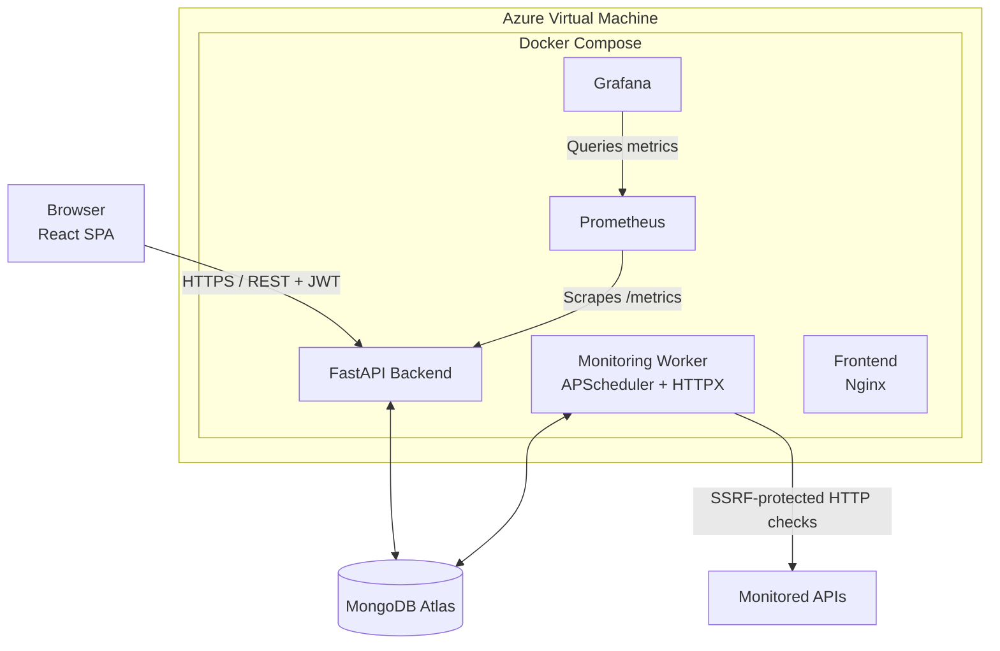

# APIWatch

**API Uptime and Performance Monitoring Platform**

Track the availability, status codes, and response times of your APIs from a single dashboard. Automatically detect outages, manage incidents, and monitor API performance.

<div align="center">

[](https://github.com/KHsalma123/apiwatch/actions/workflows/ci.yml)


</div>

---

## Features

- **Authentication:** Registration, login, JWT sessions, and protected routes. Each user can only access their own data.
- **Monitor Management:** Create, edit, pause/resume, and delete monitors. Supports GET, POST, PUT, and DELETE methods with configurable intervals, timeouts, and expected status codes.
- **Automatic Monitoring Engine:** A dedicated worker periodically checks active monitors and records their status, HTTP response codes, and response times.
- **Manual Checks:** Trigger an API check on demand.
- **Incident Management:** Automatically opens an incident when an API goes DOWN and resolves it when the API recovers.
- **Dashboard:** Displays total, UP and DOWN monitors, average response time, uptime percentage, recent incidents, and monitoring charts.
- **Monitor Details:** Latest status, uptime, recent check history, response-time charts, and incident history.
- **Responsive UI:** Sidebar navigation, loading and error states, and confirmation dialogs for destructive actions.

## Architecture



The API server and monitoring worker do not communicate directly. MongoDB is their shared data store.

### Why a separate worker?

Running scheduled monitoring jobs inside the web server could affect API responsiveness. Running multiple web server instances could also create duplicate schedulers.

The worker therefore runs as a separate process using the same backend Docker image:

1. A scheduler wakes up every 10 seconds.
2. It atomically claims monitors that are due for checking.
3. Claimed monitors are checked concurrently, with bounded concurrency.
4. Results are stored in MongoDB.
5. Monitor states are updated and incidents are automatically opened or resolved.

## Technology Stack

| Layer | Technologies |
|---|---|
| Frontend | React, Vite, Tailwind CSS, Recharts, Axios, React Router |
| Frontend Testing | Vitest, Testing Library |
| Backend | Python 3.12, FastAPI, Pydantic v2, PyMongo Async, HTTPX |
| Background Jobs | APScheduler |
| Authentication | JWT, Argon2, slowapi |
| Database | MongoDB Atlas |
| Containerization | Docker, Docker Compose, Nginx |
| Monitoring | Prometheus, Grafana |
| CI/CD | GitHub Actions |
| Cloud Infrastructure | Microsoft Azure |
| Infrastructure as Code | Terraform |
| Configuration Management | Ansible |

## Security

Security is a core requirement of APIWatch.

- **Password Hashing:** Passwords are hashed using Argon2id.
- **JWT Authentication:** Short-lived access tokens with secrets provided through environment variables.
- **Resource Ownership:** Database queries enforce user ownership. Unauthorized resource access returns 404.
- **Input Validation:** Request validation using Pydantic.
- **Rate Limiting:** Applied to authentication and manual monitoring endpoints.
- **SSRF Protection:** User-supplied monitoring URLs are validated to prevent access to internal services:
  - Only HTTP and HTTPS are allowed.
  - Restricted ports and URLs containing credentials are rejected.
  - Localhost, private, link-local, multicast, and reserved IP addresses are blocked.
  - DNS resolution is validated before connecting.
  - Requests connect to the validated IP address.
  - Redirects are followed manually and revalidated at every hop.
  - Response bodies are not downloaded.
- **CORS:** Restricted to configured frontend origins.
- **Container Security:** Application containers run as non-root users.

> Known trade-off: JWT access tokens are stored in localStorage. HttpOnly cookies with CSRF protection would provide stronger protection against XSS and remain a possible improvement.

## Monitoring with Prometheus and Grafana

APIWatch integrates Prometheus and Grafana to monitor backend availability and HTTP performance.

### Prometheus

Prometheus collects backend metrics through the FastAPI `/metrics` endpoint.

Configured metrics include:

- Total HTTP requests.
- HTTP request rates.
- Request methods.
- Response status codes.
- Request latency.

The Prometheus scrape configuration targets the backend Docker service:

```yaml
scrape_configs:
  - job_name: "apiwatch-backend"
    metrics_path: "/metrics"
    static_configs:
      - targets: ["backend:8000"]
```

### Grafana

Grafana uses Prometheus as its data source and provides an **APIWatch Monitoring Dashboard**.

The dashboard includes:

| Panel | Purpose |
|---|---|
| Backend Availability | Displays whether the backend is reachable |
| HTTP Requests | Tracks HTTP request rates by route and method |
| HTTP Errors | Displays HTTP 4xx and 5xx errors |

A Grafana alert rule, **APIWatch - HTTP 5xx Errors**, monitors server-side errors and enters the firing state when the configured threshold is exceeded.

Prometheus and Grafana are bound to localhost on the Azure VM and are not directly exposed to the public internet.

## Data Model

| Collection | Purpose | Key Indexes |
|---|---|---|
| `users` | User accounts | Unique `email` |
| `monitors` | Monitor configuration and latest state | `(user_id, created_at)`, `(is_active, next_check_at)` |
| `check_results` | Monitoring history | `(monitor_id, checked_at)`, TTL on `checked_at` |
| `incidents` | Outage periods | `(user_id, started_at)`, `(monitor_id, started_at)`, unique partial index for open incidents |

Check results reference their monitor instead of being embedded, because monitoring history grows continuously.

The latest monitor state is denormalized onto the monitor document to simplify dashboard queries.

## Getting Started

### Prerequisites

- Docker Desktop or Docker Engine with Docker Compose.
- Git.
- Python 3.12 and Node.js 22 are required only for running without Docker.

### Quick Start with Docker Compose

Clone the repository:

```bash
git clone https://github.com/KHsalma123/apiwatch.git
cd apiwatch
```

Create the local environment file:

```bash
cp .env.example .env
```

Generate a secure JWT secret:

```bash
python -c "import secrets; print(secrets.token_urlsafe(48))"
```

Set the generated value in `.env` as `JWT_SECRET`.

Configure the required environment variables, including the MongoDB connection string and JWT secret.

Start the application:

```bash
docker compose up --build -d
```

Access the services:

| Service | URL |
|---|---|
| Web Application | http://localhost:8080 |
| API Documentation | http://localhost:8000/docs |

Create an account and add a monitor, for example:

```text
https://api.github.com
```

The first monitoring result should appear within seconds.

### Using MongoDB Atlas

To use MongoDB Atlas instead of the bundled local MongoDB container:

1. Configure `MONGODB_URI` with your Atlas connection string.
2. Allow the appropriate client IP in Atlas Network Access.
3. Ensure the database name is configured through `MONGODB_DB`.

Never commit your `.env` file.

## Development Without Docker

### 1. Start MongoDB

```bash
docker run -d --name apiwatch-mongo \
  -p 127.0.0.1:27017:27017 \
  mongo:7
```

### 2. Start the Backend API

```bash
cd backend

python -m venv .venv
source .venv/bin/activate

pip install -r requirements-dev.txt
cp .env.example .env

uvicorn app.main:app --reload
```

Configure `JWT_SECRET` and `MONGODB_URI` in the backend environment file.

### 3. Start the Monitoring Worker

Open another terminal:

```bash
cd backend
source .venv/bin/activate
python -m app.monitoring.worker
```

### 4. Start the Frontend

Open another terminal:

```bash
cd frontend

npm install
npm run dev
```

The development frontend is available at:

```text
http://localhost:5173
```

## Configuration

Application settings are provided through environment variables.

| Variable | Description | Default |
|---|---|---|
| `MONGODB_URI` | MongoDB connection string | Required |
| `MONGODB_DB` | Database name | `apiwatch` |
| `JWT_SECRET` | Token signing secret | Required |
| `ACCESS_TOKEN_EXPIRE_MINUTES` | Access token lifetime | `60` |
| `CORS_ORIGINS` | Allowed frontend origins | Local development origin |
| `RATE_LIMIT_ENABLED` | Enables rate limiting | `true` |
| `MAX_MONITORS_PER_USER` | Maximum monitors per user | `20` |
| `MIN_INTERVAL_SECONDS` | Minimum check interval | `30` |
| `RESULTS_RETENTION_DAYS` | Check history retention | `30` |
| `WORKER_TICK_SECONDS` | Worker scheduling interval | `10` |
| `WORKER_CONCURRENCY` | Maximum concurrent checks | `20` |

See `.env.example` for the complete configuration template.

## API Overview

Base path: `/api/v1`

All endpoints except registration, login, and health require a valid bearer token.

| Area | Endpoints |
|---|---|
| Authentication | `POST /auth/register`, `POST /auth/login` |
| User | `GET /users/me`, `PATCH /users/me`, `POST /users/me/change-password` |
| Monitors | `GET/POST /monitors`, `GET/PUT/DELETE /monitors/{id}` |
| Monitor Actions | `PATCH /monitors/{id}/active`, `POST /monitors/{id}/check` |
| Monitoring Data | `GET /monitors/{id}/results`, `GET /monitors/{id}/stats`, `GET /monitors/{id}/chart`, `GET /monitors/{id}/incidents` |
| Incidents | `GET /incidents`, `GET /incidents/{id}` |
| Dashboard | `GET /dashboard/summary`, `GET /dashboard/charts` |
| System | `GET /health` |
| Metrics | `GET /metrics` |

Interactive API documentation is available at `/docs`.

## Testing

### Backend Tests

The backend test suite covers:

- Authentication and JWT handling.
- Password security.
- Monitor creation and validation.
- Resource ownership isolation.
- SSRF protection.
- Monitoring checker behavior.
- Redirect and connection error handling.
- Incident lifecycle: UP → DOWN → UP.

Run the backend tests:

```bash
cd backend

python -m venv .venv
source .venv/bin/activate

pip install -r requirements-dev.txt
python -m pytest -v
```

A MongoDB instance must be reachable at the URI configured in the test environment. The test configuration uses a separate `apiwatch_test` database.

**Local backend test validation:** 72 tests passed.

### Frontend Tests

```bash
cd frontend
npm install
npm test
```

Frontend tests cover formatting helpers, status badges, protected routes, and confirmation dialogs.

The tests use mocked DNS and HTTP behavior where appropriate, avoiding real external API requests.

## CI/CD

GitHub Actions automates application validation and Docker image delivery.

The CI workflow (`.github/workflows/ci.yml`) runs on pushes to `main`, pull requests, and manual execution.

It includes three jobs:

1. **Backend:** installs development dependencies and runs the test suite using a MongoDB service container.
2. **Frontend:** installs dependencies, runs frontend tests, and builds the production application.
3. **Docker:** builds backend and frontend Docker images using Docker Buildx and publishes them to GitHub Container Registry (GHCR) on non-pull-request events.

Docker image tags include `latest` and the corresponding Git commit SHA.

[GitHub Actions – APIWatch](https://github.com/KHsalma123/apiwatch/actions)

## Azure Deployment

APIWatch is deployed on a Microsoft Azure Ubuntu Virtual Machine using Docker Compose.

The deployment architecture includes:

- React frontend served through Nginx.
- FastAPI backend.
- Dedicated monitoring worker.
- Prometheus metrics collection.
- Grafana dashboards and alert rules.
- MongoDB Atlas as the managed database.

The application-specific Azure configuration is defined in:

- `docker-compose.azure.yml`
- `monitoring/prometheus/prometheus.yml`

The infrastructure automation is maintained separately:

[APIWatch Infrastructure Repository](https://github.com/KHsalma123/apiwatch-infrastructure)

See `docs/AZURE.md` for deployment guidance.
The Azure VM can be started when needed and stopped and deallocated when not in use to reduce compute costs.

## Project Structure

```text
apiwatch/
├── backend/
│   ├── app/
│   │   ├── core/          # Settings and rate limiting
│   │   ├── database/      # MongoDB connection and indexes
│   │   ├── security/      # Password hashing, JWT and SSRF protection
│   │   ├── schemas/       # Pydantic models
│   │   ├── services/      # Business logic
│   │   ├── routers/       # REST API endpoints
│   │   ├── monitoring/    # Checker and worker
│   │   └── main.py
│   ├── tests/
│   ├── Dockerfile
│   └── requirements.txt
├── frontend/
│   └── src/
├── monitoring/
│   └── prometheus/
│       └── prometheus.yml
├── docs/
│   └── AZURE.md
├── .github/
│   └── workflows/
├── docker-compose.yml
├── docker-compose.azure.yml
└── README.md
```

## Roadmap

- [ ] Email notifications for DOWN and recovery events.
- [ ] Confirmation retries before declaring an API DOWN.
- [ ] Custom request headers and request bodies.
- [ ] Response content assertions.
- [ ] Slack, Discord, and webhook notifications.
- [ ] Public status pages.
- [ ] SSL certificate expiry monitoring.
- [ ] HttpOnly cookie sessions and refresh tokens.
- [ ] Automated Azure deployment improvements.

## Author

**Salma Kh** Computer Engineering Student – Software Engineering

## Related Repository

- [APIWatch Application](https://github.com/KHsalma123/apiwatch)
- [APIWatch Infrastructure](https://github.com/KHsalma123/apiwatch-infrastructure)

## License

MIT License.
