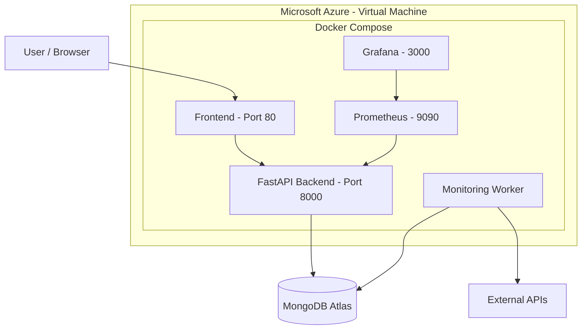

# Déploiement Azure – APIWatch

## 1. Vue d'ensemble

APIWatch est déployé sur une machine virtuelle Linux hébergée sur Microsoft Azure.

L'application utilise Docker Compose pour exécuter ses différents services. MongoDB Atlas assure la persistance des données, tandis que Prometheus et Grafana permettent de surveiller les performances et la disponibilité du backend.

### Infrastructure Azure

| Ressource | Configuration |
|---|---|
| Cloud provider | Microsoft Azure |
| Resource Group | `rg-apiwatch-dev` |
| Virtual Machine | `vm-apiwatch` |
| Region | Belgium Central |
| Availability Zone | Zone 2 |
| VM Size | `Standard_B2s_v2` |
| Operating System | Linux |
| Container Runtime | Docker |
| Orchestration | Docker Compose |

> La VM est actuellement arrêtée et désallouée lorsqu'elle n'est pas utilisée afin de limiter les coûts de calcul.

## 2. Architecture de déploiement

L'architecture repose sur les composants suivants :

| Composant | Rôle |
|---|---|
| Frontend | Interface utilisateur accessible via HTTP sur le port 80 |
| Backend | API REST développée avec FastAPI, accessible en interne sur le port 8000 |
| Worker | Exécution périodique des vérifications des API surveillées |
| MongoDB Atlas | Stockage des utilisateurs, monitors et incidents |
| Prometheus | Collecte des métriques du backend |
| Grafana | Visualisation des métriques et suivi des alertes |

### Architecture globale



Prometheus et Grafana sont liés à des ports locaux de la VM (`127.0.0.1`) et ne sont pas directement exposés sur Internet.

## 3. Provisionnement de l'infrastructure avec Terraform

Terraform est utilisé pour définir et provisionner les ressources Azure.

Les fichiers principaux se trouvent dans le dépôt d'infrastructure :

- `main.tf` : définition des ressources Azure.
- `providers.tf` : configuration du fournisseur Azure.
- `variables.tf` : déclaration des variables.
- `outputs.tf` : sorties Terraform.

### Commandes principales

Initialiser Terraform :

```bash
terraform init
```

Vérifier le formatage :

```bash
terraform fmt -check -recursive
```

Valider la configuration :

```bash
terraform validate
```

Prévisualiser les changements :

```bash
terraform plan
```

**Important :** le provisionnement ou la modification des ressources avec `terraform apply` reste une opération manuelle. Le workflow CI ne déclenche pas automatiquement de création ou de modification de ressources Azure.

## 4. Déploiement avec Ansible

Ansible automatise la préparation de la VM et le déploiement de l'application.

Les principaux playbooks sont :

- `ansible/install-docker.yml` : installation de Docker et Docker Compose.
- `ansible/deploy-apiwatch.yml` : configuration et déploiement de l'application.

### Vérifier la connexion SSH

```bash
ansible -i ansible/inventory.ini apiwatch -m ping
```

### Vérifier la syntaxe des playbooks

```bash
ansible-playbook -i ansible/inventory.ini ansible/install-docker.yml --syntax-check
```

```bash
ansible-playbook -i ansible/inventory.ini ansible/deploy-apiwatch.yml --syntax-check
```

### Exécuter le déploiement

```bash
ansible-playbook -i ansible/inventory.ini ansible/deploy-apiwatch.yml --ask-vault-pass
```

Le déploiement utilise Ansible Vault pour protéger les variables d'environnement sensibles.

Le fichier chiffré est stocké dans :

```text
ansible/files/apiwatch.env.vault
```

Le mot de passe Vault doit rester privé et ne doit jamais être ajouté au dépôt Git.

## 5. Exécution avec Docker Compose

L'application utilise le fichier :

```text
docker-compose.azure.yml
```

Les services sont exécutés sur la VM.

Pour vérifier leur état :

```bash
docker compose -f docker-compose.azure.yml ps
```

Pour consulter les logs :

```bash
docker compose -f docker-compose.azure.yml logs -f
```

Pour arrêter les services :

```bash
docker compose -f docker-compose.azure.yml down
```

Pour les redémarrer :

```bash
docker compose -f docker-compose.azure.yml up -d
```

## 6. Monitoring avec Prometheus et Grafana

APIWatch intègre une solution de monitoring composée de Prometheus et Grafana.

### Prometheus

Prometheus collecte les métriques HTTP exposées par le backend sur :

```text
/metrics
```

La configuration se trouve dans :

```text
monitoring/prometheus/prometheus.yml
```

La fréquence de collecte est de 15 secondes.

### Grafana

Grafana utilise Prometheus comme source de données.

Le dashboard **APIWatch Monitoring Dashboard** permet notamment de suivre :

- Backend Availability.
- HTTP Requests.
- HTTP Errors.

Une règle d'alerte est également configurée pour détecter les erreurs HTTP 5xx.

Les interfaces Prometheus et Grafana sont accessibles localement sur la VM, respectivement sur les ports 9090 et 3000. L'accès depuis un poste distant peut être réalisé avec un tunnel SSH ou un transfert de port.

## 7. Sécurité

Plusieurs mesures sont mises en place :

- Les secrets de l'application sont protégés avec Ansible Vault.
- Le fichier `.env` n'est pas versionné dans Git.
- Les permissions du fichier `.env` sur la VM sont limitées.
- Les ports de monitoring ne sont pas exposés publiquement.
- Les règles NSG contrôlent les accès réseau à la VM.
- L'accès SSH est restreint aux sources autorisées.
- Les fichiers Terraform sensibles, notamment les états, ne sont pas publiés.

## 8. CI/CD avec GitHub Actions

Le projet contient deux workflows GitHub Actions :

```text
.github/workflows/
├── ci.yml
└── deploy-azure.yml
```

### 8.1 Continuous Integration

Le workflow `ci.yml` s'exécute lors des événements configurés dans le fichier, notamment les push et les pull requests vers `main`.

Il automatise les vérifications définies dans le pipeline afin de détecter les problèmes avant l'intégration des modifications.

### 8.2 Déploiement Azure – Workflow préparé

Le workflow `deploy-azure.yml` est **préparé, mais n'est pas utilisé pour le déploiement actuel**.

Il est déclenché manuellement depuis l'interface GitHub Actions (`workflow_dispatch`) et nécessite que les ressources Azure correspondantes existent déjà.

Son objectif est de :

1. S'authentifier auprès d'Azure avec OpenID Connect (OIDC).
2. Se connecter à Azure Container Registry (ACR).
3. Construire et publier l'image Docker du backend.
4. Mettre à jour les images des applications Azure Container Apps `apiwatch-api` et `apiwatch-worker`.

Le workflow ne crée aucune ressource Azure. Il met uniquement à jour des ressources déjà provisionnées.

Les secrets GitHub nécessaires sont :

- `AZURE_CLIENT_ID`
- `AZURE_TENANT_ID`
- `AZURE_SUBSCRIPTION_ID`
- `AZURE_RESOURCE_GROUP`
- `ACR_LOGIN_SERVER`

L'authentification OIDC évite de stocker un mot de passe Azure permanent dans GitHub.

> **Important :** ce workflow constitue une préparation à une future évolution vers Azure Container Apps et Azure Static Web Apps. Le déploiement actuellement utilisé repose sur une VM Azure et Docker Compose. Le workflow `deploy-azure.yml` n'est donc pas le mécanisme de déploiement de cette VM.

Le provisionnement Terraform reste une opération manuelle et indépendante. Aucun `terraform apply` n'est exécuté automatiquement par les workflows.

## 9. Gestion des coûts

Le projet utilise Azure for Students et ses crédits disponibles.

Pour limiter les coûts :

- La VM est arrêtée et désallouée lorsqu'elle n'est pas utilisée.
- Les ressources persistantes, comme les disques et certaines ressources réseau, peuvent continuer à générer des frais.
- MongoDB Atlas est utilisé séparément d'Azure.
- Les ressources inutilisées doivent être supprimées lorsqu'elles ne sont plus nécessaires.
- Azure Cost Management permet de suivre la consommation et de configurer des alertes budgétaires.

Pour consulter les dépenses :

[Azure Cost Management](https://portal.azure.com/#view/Microsoft_Azure_CostManagement/Menu/~/costanalysis)

## 10. Ressources associées

- [APIWatch – Application](https://github.com/KHsalma123/apiwatch)
- [APIWatch – Infrastructure](https://github.com/KHsalma123/apiwatch-infrastructure)
- [Microsoft Azure Documentation](https://learn.microsoft.com/azure/)
- [Terraform Azure Provider](https://registry.terraform.io/providers/hashicorp/azurerm/latest/docs)
- [Ansible Documentation](https://docs.ansible.com/)
